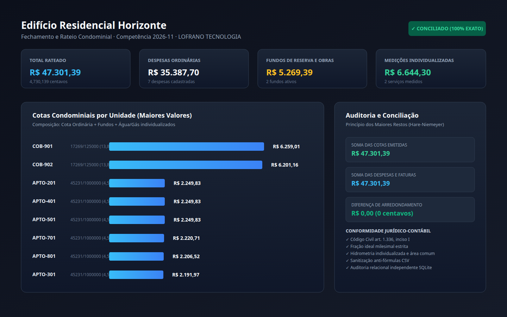

# Rateio Condominial por Fração Ideal e Centavos Exatos

[](https://github.com/martinlofranodeoliveira/rateio-condominio-fracoes/actions/workflows/ci.yml)
[](https://www.python.org/downloads/)
[](LICENSE)
[-brightgreen.svg)](#)

Motor determinístico e auditável de rateio de despesas condominiais com cálculo estrito em **fração ideal milesimal**, **medições individualizadas de água e gás** e **conservação exata de centavos** sem ponto flutuante.

Desenvolvido para atender às exigências legais da legislação condominial brasileira (**Código Civil, art. 1.336, inciso I**, e **Lei 4.591/64**), eliminando divergências de arredondamento e garantindo conformidade contábil e jurídica.



---

## Destaques de Engenharia

- **Aritmética Inteira Exata (Zero Floats):** Todas as transações e saldos operam em centavos inteiros (`int`), e todas as frações ideais utilizam números racionais exatos (`fractions.Fraction`). Banimento total de números de ponto flutuante IEEE-754.
- **Algoritmo dos Maiores Restos (Hare-Niemeyer / Hamilton):** Distribui os centavos indivisíveis de forma determinística, garantindo por prova matemática que a soma de todas as cotas emitidas fecha **exatamente** na soma das despesas aprovadas:
  $$\sum \text{cotas\_unidades} \equiv \text{despesas\_ordinarias} + \text{fundos} + \text{medicoes}$$
- **Medições Individualizadas e Área Comum:** Apura hidrômetros e medidores de gás por unidade (leitura atual menos leitura anterior). O consumo excedente da fatura geral é identificado como área comum e rateado pelas frações ideais.
- **Fundos Parametrizáveis com Elegibilidade:** Suporta fundo de reserva proporcional às despesas ordinárias, fundos de obras com valor fixo global e taxas extras com cota fixa por unidade, respeitando isenções convencionais.
- **Segurança Ativa em CSV:** Prevenção contra injeção de fórmulas (*CSV/Formula Injection*) com prefixação automática de `'` em caracteres potencialmente maliciosos (`=`, `+`, `-`, `@`, `\t`).
- **Codec JSON Canônico:** Rejeição rigorosa de floats, chaves duplicadas, assinaturas BOM e recursão excessiva.
- **Empacotamento Determinístico em ZIP:** Exportação atômica via `os.O_EXCL` e timestamps fixados para garantia de reprodutibilidade bit a bit.
- **Zero Dependências Externas:** Executa puramente sobre a biblioteca padrão do Python 3.11+, sem necessidade de pacotes de terceiros.
- **Auditor Independente:** Script de auditoria relacional (`tools/verify_independent.py`) que confronta os CSVs em `sqlite3` sem importar o código-fonte de produção.

---

## Instalação

O pacote pode ser instalado diretamente via pip ou executado localmente:

```bash
# Instalação a partir do repositório
pip install git+https://github.com/martinlofranodeoliveira/rateio-condominio-fracoes.git

# Ou clone para desenvolvimento local
git clone https://github.com/martinlofranodeoliveira/rateio-condominio-fracoes.git
cd rateio-condominio-fracoes
pip install -e .
```

---

## Uso Rápido via CLI

A CLI disponibiliza comandos estruturados para validação e fechamento mensal:

```bash
# 1. Exibir versão instalada
rateio-condominio-fracoes versao

# 2. Gerar arquivo JSON de exemplo canônico
rateio-condominio-fracoes exemplo -o entrada.json

# 3. Validar consistência dos dados e frações ideais
rateio-condominio-fracoes verificar -i entrada.json

# 4. Visualizar resumo do balancete em Markdown no terminal
rateio-condominio-fracoes resumo -i entrada.json

# 5. Processar fechamento completo e gerar artefatos analíticos
rateio-condominio-fracoes processar \
  -i entrada.json \
  -d ./saida \
  -z ./saida/fechamento-2026-11.zip
```

---

## Exemplo de Entrada

```json
{
  "condominio": {
    "nome": "Edifício Residencial Horizonte",
    "competencia": "2026-11"
  },
  "unidades": [
    {"id": "APTO-101", "fracao_ideal_numerador": 45231, "fracao_ideal_denominador": 1000000},
    {"id": "APTO-102", "fracao_ideal_numerador": 45231, "fracao_ideal_denominador": 1000000},
    {"id": "COB-901", "fracao_ideal_numerador": 138152, "fracao_ideal_denominador": 1000000}
  ],
  "despesas_ordinarias": [
    {"id": "DESP-01", "descricao": "Portaria e Limpeza", "categoria": "pessoal", "valor_centavos": 1850000},
    {"id": "DESP-02", "descricao": "Manutenção Elevadores", "categoria": "manutencao", "valor_centavos": 235000}
  ],
  "fundos": [
    {"id": "FUNDO-RESERVA", "descricao": "Reserva (5%)", "tipo": "percentual_ordinarias", "percentual_numerador": 5, "percentual_denominador": 100}
  ],
  "medicoes": [
    {
      "servico": "agua",
      "unidade_medida": "m3",
      "valor_fatura_concessionaria_centavos": 465890,
      "consumo_fatura": 320,
      "leituras": [
        {"unidade_id": "APTO-101", "leitura_anterior": 140, "leitura_atual": 154},
        {"unidade_id": "APTO-102", "leitura_anterior": 98, "leitura_atual": 110},
        {"unidade_id": "COB-901", "leitura_anterior": 410, "leitura_atual": 435}
      ]
    }
  ]
}
```

---

## Artefatos Gerados

Na pasta de saída e dentro do arquivo ZIP, são gerados os seguintes artefatos:

| Arquivo | Descrição |
| :--- | :--- |
| `resumo-unidades.csv` | Tabela consolidada com todas as unidades, frações, quotas ordinárias, fundos e totais |
| `despesas-detalhadas.csv` | Discriminação completa de todas as despesas ordinárias e fundos cadastrados |
| `medicoes-hidrometros.csv` | Leituras de consumo, parcelas individuais e rateio da área comum |
| `relatorio-fechamento.md` | Demonstrativo financeiro analítico pronto para anexar à ata de condomínio |
| `painel-rateio.svg` | Painel gráfico vetorial de alta definição (1440×900) para conferência visual |
| `rateio.json` | Memória de cálculo estruturada para integração contábil e emissão de boletos |
| `SHA256SUMS` | Manifesto criptográfico SHA-256 de auditoria e verificação de integridade |

---

## Verificação e Auditoria Independente

O projeto inclui um verificador independente que audita o pacote gerado sem importar o código-fonte da aplicação:

```bash
python3 tools/verify_independent.py saida/fechamento-2026-11.zip
```

Saída esperada:
```
=== Auditoria Independente: fechamento-2026-11.zip ===
  ✓ Integridade criptográfica SHA-256 verificada com sucesso em todos os artefatos.
  ✓ Frações ideais da entrada somam exatamente 1/1 (18 unidades).
  • Total Ordinárias: Cobrado = 3538770 centavos | Despesas = 3538770 centavos
  • Total Fundos: Cobrado = 526939 centavos | Despesas = 526939 centavos
  • Total Medições: Cobrado = 664430 centavos | Medições = 664430 centavos
  ✓ Fechamento exato confirmado: 4730139 centavos auditados e validados.
=== Auditoria Independente APROVADA com 100% de sucesso! ===
```

---

## Documentação Técnica

- [Especificação de Formato JSON e CSV](docs/FORMATO.md)
- [Referência da API Python](docs/API.md)
- [Prova Matemática e Verificação Independente](docs/VERIFICACAO.md)
- [Guia de Interoperabilidade e Integração ERP](docs/INTEROPERABILIDADE.md)

---

## Licença

Distribuído sob a licença **MIT**. Consulte o arquivo [LICENSE](LICENSE) para mais detalhes.

Copyright (c) 2026 Martin Lofrano / **LOFRANO TECNOLOGIA**.
